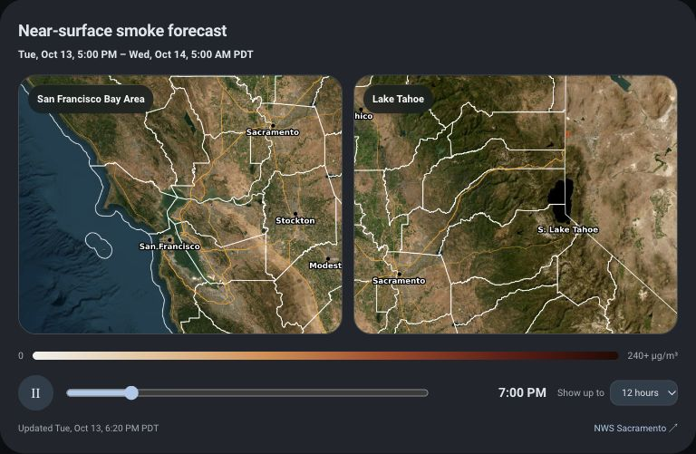

# HRRR Smoke Forecast Card

A Home Assistant dashboard card for hourly near-surface smoke forecast images. Its default source is NWS Sacramento, with cropped views for the San Francisco Bay Area and Lake Tahoe. The card follows Home Assistant theme colors and adapts to narrow screens.


## Preview



Default NWS Sacramento source with Bay Area and Tahoe example views. Forecast times and imagery change as new runs are published.

## Install

1. Copy [`hrrr-smoke-card.js`](hrrr-smoke-card.js) to your Home Assistant `/config/www/` directory.
2. In Home Assistant, add `/local/hrrr-smoke-card.js?v=1` as a **JavaScript module** dashboard resource. The dashboard resource editor is under **Settings → Dashboards → Resources**. If you manage resources in YAML, add:

   ```yaml
   lovelace:
     resource_mode: yaml
     resources:
       - url: /local/hrrr-smoke-card.js?v=1
         type: module
   ```

   YAML resource management is an explicit Home Assistant setting; existing UI-managed resources should be added in the dashboard resource editor instead.
3. Add this card to a dashboard:

   ```yaml
   type: custom:hrrr-smoke-card
   ```

   For a full-width card in a sections dashboard, add `grid_options: {columns: full}`.

4. Refresh the dashboard browser tab. After updating the JavaScript file later, increase the `v=` number in the resource URL to clear browser caches.

The card works with storage-managed and YAML dashboards. The default setup needs no API key, Home Assistant integration, or local image generation. The viewing browser must be able to reach `www.weather.gov`.

### Configuration reference

| Option | Default | Use |
| --- | --- | --- |
| `title` | `Near-surface smoke forecast` | Card heading |
| `subtitle` | Hidden | Optional short explanatory line |
| `regions` | Bay Area and Tahoe | One or more named image views |
| `regions[].name` | Required for custom views | Label shown over the map |
| `regions[].sector` | `cwa` | Replaces `{sector}` in the URL |
| `regions[].position` | `center` | CSS `background-position` |
| `regions[].size` | `cover` | CSS `background-size` |
| `horizons` | `[6, 12, 24]` | Choices in the forecast range selector, up to 48 |
| `time_zone` | `America/Los_Angeles` | IANA time zone used for the forecast window, frame time, and update time |
| `forecast_start_offset_hours` | `-1` for the default NWS source | Hours from the image publication hour to the valid time of F00; set for another source to show clock times |
| `image_template` | NWS Sacramento hourly image URL | URL pattern with `{hour}` or `{hour3}` |
| `source_name` / `source_url` | NWS Sacramento page | Source link and attribution |
| `show_legend` | On for the default source; off for custom templates | Show the NWS color ramp |

## Forecast range

The card has a **Show up to** selector for 6, 12, and 24 forecast hours. For the default NWS Sacramento source, the top line shows the clock time of the first and last available frames, such as `Tue, Oct 13, 5:00 PM – Wed, Oct 14, 5:00 AM PDT`. The time beside the scrubber shows the selected frame's clock time. The default `America/Los_Angeles` zone switches between PDT and PST automatically; set `time_zone` to another IANA zone if desired.

The NWS graphics do not expose a machine-readable valid time. The card estimates F00 as one hour before the hour on the image's `Last-Modified` timestamp, matching the current NWS Sacramento publication pattern. Check the valid time printed on the full source image if exact timing matters. If that pattern changes, adjust `forecast_start_offset_hours`; for another source, set it to that source's offset. Without an offset for a custom source, the card falls back to F00 notation rather than showing an unverified clock time.

Selecting 12 or 24 hours does not create missing forecasts. If the source has published only F00–F03 from the current run, the card stops at F03 and shows the window through the last available frame. As more matching frames are published, the card includes them on its next refresh.

## Choose regions and images

By default, the two views use the Sacramento regional image (`cwa`) with different CSS crops. You can choose any combination of the Sacramento sectors: `cwa` (regional), `north`, `central` (Sacramento and Tahoe), and `south`. For example:

```yaml
type: custom:hrrr-smoke-card
title: Northern California smoke
regions:
  - name: Tahoe region
    sector: central
    position: center
    size: contain
  - name: Northern Valley
    sector: north
    position: center
    size: contain
horizons: [6, 12, 24]
time_zone: America/Los_Angeles
```

`position` and `size` are CSS `background-position` and `background-size` values. Use `cover` or `contain` to show a whole sector image; use percentages and a larger size to crop into a place. The card checks every selected sector and keeps only hours available from the same run in all views.

For another image series, set `image_template`. It must include `{hour}` for two-digit forecast hours (or `{hour3}` for three digits); `{sector}` is optional. Configure its attribution and views as well:

```yaml
type: custom:hrrr-smoke-card
image_template: https://example.org/smoke/{sector}/forecast-{hour3}.png
source_name: Forecast image provider
source_url: https://example.org/forecast
subtitle: Near-surface smoke forecast
regions:
  - name: My region
    sector: west
    position: center
    size: contain
horizons: [6, 12, 24]
time_zone: America/New_York
forecast_start_offset_hours: 0
```

The image host must allow browser `HEAD` requests across origins and provide an `image/*` content type plus a `Last-Modified` header. Files must represent hourly forecast steps and stable filenames for each hour. The card rejects frames with publication times more than 45 minutes apart. If the host uses another publication format or blocks cross-origin browser requests, you will need a compatible image proxy or adapter. The colored NWS legend is hidden for custom templates; set `show_legend: true` only if that scale matches your source.

**Geographic coverage:** the built-in NWS Sacramento source covers Northern and Central California. Other places require a compatible forecast-image source and a suitable view or crop. This card does not supply a nationwide image feed by itself.

### Troubleshooting

- **Custom element doesn't exist:** confirm the JavaScript module resource URL and refresh the browser. Files under `/config/www/` appear under `/local/` in Home Assistant.
- **Blank map with “Forecast unavailable”:** open the image URL in the same browser and check whether the host allows cross-origin `HEAD` requests with readable `Last-Modified` and `Content-Type` headers. A server-side proxy can provide those headers for hosts that do not.
- **Only a few hours available:** check the source page. The card intentionally omits forecast-hour files left over from older runs; selecting 24 hours cannot fill an incomplete publication.
- **Playback pauses briefly between frames:** the card waits for the next image to finish loading and decoding, so slow connections hold the current map rather than flashing an empty one.
- **Map crop misses your area:** change the view's `sector`, `position`, and `size`. Select a map to inspect its full source image.
- **An update does not appear:** increase the resource URL's `v=` number and reload the dashboard.

## Behavior

- Checks the selected images when the card opens and every two hours while it is displayed.
- Reads image `Last-Modified` headers and keeps only consecutive frames from the same forecast publication. This avoids mixing an old forecast with a newly published run.
- Marks a forecast image older than six hours as potentially stale. If the source cannot be reached, it displays an unavailable status.
- Preloads and decodes the next image, then swaps both map views together. Slow images hold the current frame; playback never advances the hour label ahead of the visible maps.
- Plays the available forecast hours, with pause and scrub controls. Select either map to open the full NWS image.

The default colored map is a **forecast of near-surface smoke concentration**, not a live air-quality measurement or AQI. If a source changes its map layout, crop positions may need updating. Default source and forecast context: [NWS Sacramento Experimental Smoke Forecast](https://www.weather.gov/sto/ExperimentalSmokeForecast).

## Optional animated WebP builder

[`tools/nws_smoke_loop.py`](tools/nws_smoke_loop.py) produces animated `bay-area.webp`, `tahoe.webp`, and `manifest.json` from the default Sacramento images for uses outside the Home Assistant card. The card plays source images directly, so smooth playback does not require a video conversion job and retains the hour selector and full-image links.

```sh
python3 -m venv .venv
.venv/bin/pip install -r tools/requirements.txt
.venv/bin/python tools/nws_smoke_loop.py output
```

Run the last command every two hours if you want locally generated loops. It skips unchanged publications and refuses stale or incomplete ones. Generated files in `output/` are ignored by Git.

## Data and privacy

With the default configuration, the card requests public images from `www.weather.gov` in the browser. It does not read Home Assistant entities or credentials and does not send telemetry. The samples contain no household information. Use the forecast as context alongside local sensor data and official air-quality guidance.

## Releases

Milestones use Git tags and GitHub Releases named `vMAJOR.MINOR.PATCH`. Release notes describe user-visible changes, configuration changes, and verification. While the card is in the `0.x` series, minor releases may change configuration; patch releases fix behavior without intentionally changing it. See [CHANGELOG.md](CHANGELOG.md) for the history.

## License

MIT. NWS imagery remains subject to its source terms and attribution.
